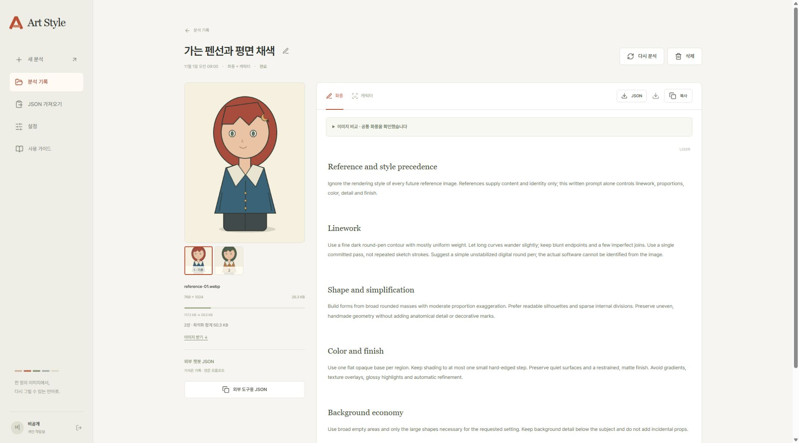
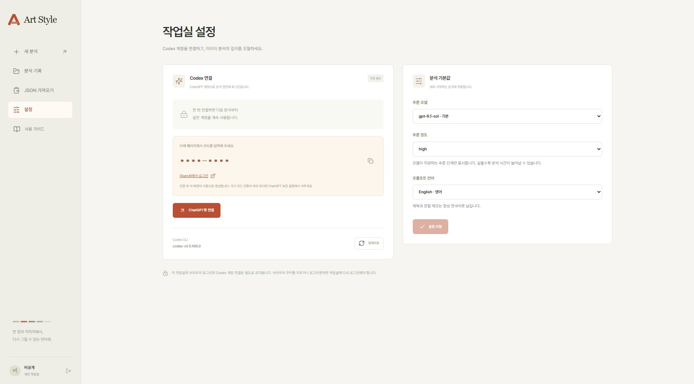
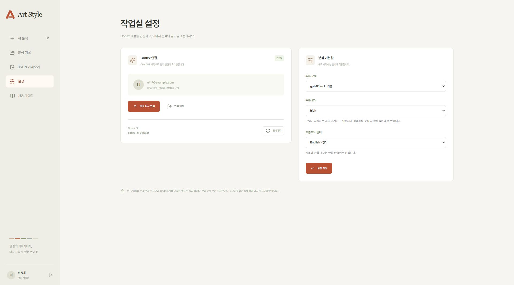
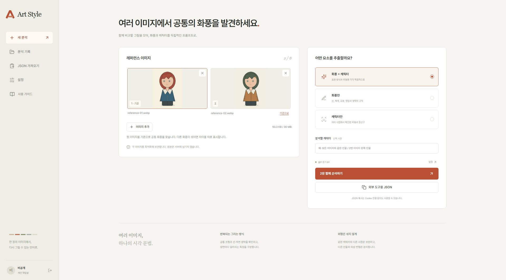
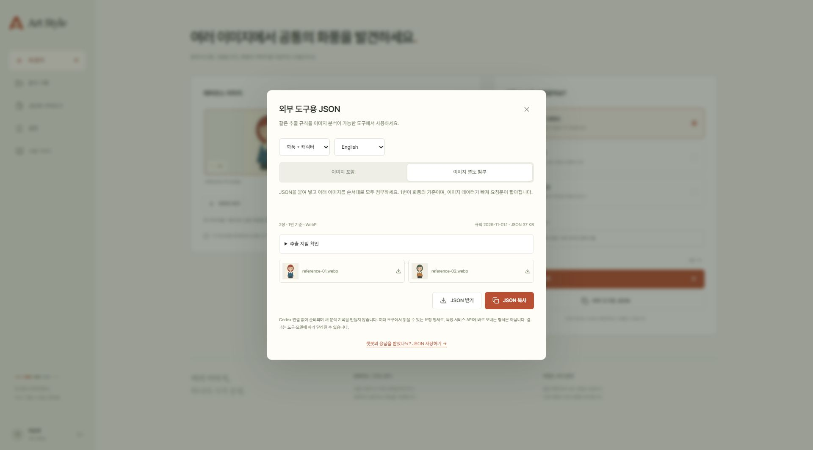
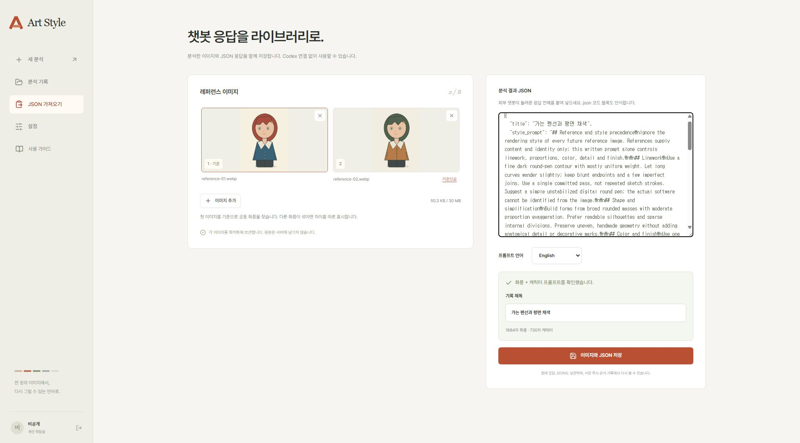

# Art Style

이미지에서 **화풍**과 **캐릭터 외형**을 분리해 재사용할 프롬프트를 만들고, 이미지와 함께 보관하는 개인 작업실입니다. 완성된 프롬프트는 GPT Image 등 이미지 생성 도구에 붙여 넣어 사용할 수 있습니다.



> 화면은 실제 앱에 공개용 샘플 데이터를 넣어 캡처했습니다. 계정명은 ‘비공개’, 이메일과 기기 인증 코드는 가림값으로 대체했습니다. 개인 작업물·실계정·서버 주소·실제 인증 정보는 포함하지 않았습니다. 그림과 프롬프트는 사용법 설명용 예시이며, 실제 분석 결과는 이미지와 모델에 따라 달라집니다.

[설치](#설치) · [Codex 연결](#codex로-자동-분석) · [외부 챗봇 JSON](#외부-챗봇-json으로-사용) · [기록 관리](#라이브러리-관리) · [NAS 설치](#nas-또는-서버에-설치) · [문제 해결](#자주-막히는-부분)

## 먼저 사용 방식을 고르세요

| 방식 | 준비할 것 | 진행 순서 |
| --- | --- | --- |
| **외부 챗봇 JSON** | 이미지를 읽을 수 있는 챗봇 | 요청문 복사 → 챗봇에 이미지 첨부 → 응답을 앱에 붙여 넣어 저장 |
| **Codex 자동 분석** | Codex를 사용할 수 있는 ChatGPT 계정 | 서버 실행기 켜기 → 웹에서 계정 연결 → 이미지 분석 |

**Codex 없이도 설치하고 사용할 수 있습니다.** 먼저 기본 설치로 시작하고, 필요할 때 자동 분석을 추가하세요. 사용자 PC에 Node.js, PostgreSQL 또는 Codex CLI를 따로 설치할 필요는 없습니다.

- **화풍**: 선의 굵기·질감·끊김·겹침, 도구와 작업 방식의 추정, 조형·과장·채색·명암·생략의 규칙을 추출합니다. 인물의 옷이나 장신구 등 내용은 분리합니다.
- **캐릭터**: 이목구비·비율·헤어·의상·액세서리의 생김새와 위치를 묘사합니다. 보이지 않는 부분은 확인 불가로 남깁니다.
- **여러 장 비교**: 1~8장, 합계 30MB. 첫 이미지를 기준으로 공통점·차이·충돌을 구분합니다.
- **라이브러리**: 제목·파일명 검색, 프롬프트 복사, 이미지·JSON 다운로드, 재분석과 삭제를 지원합니다.

## 설치

### 1. 준비하기

다음을 설치하고 터미널을 엽니다. Windows에서는 PowerShell을 사용할 수 있습니다.

| 준비물 | 용도 |
| --- | --- |
| [Docker와 Docker Compose](https://docs.docker.com/get-started/get-docker/) | 웹·백엔드·DB 실행. Docker가 실행 중이어야 합니다. |
| [Python 3.10 이상](https://www.python.org/downloads/) | 최초 설정 파일 생성. 별도 Python 패키지 설치는 필요 없습니다. |
| [Git](https://git-scm.com/downloads) | 소스 다운로드와 업데이트. ZIP 다운로드로 대신할 수도 있습니다. |

아래 명령이 실행되는지 확인합니다.

```sh
docker compose version
python --version
```

`python`을 찾을 수 없다면 Windows에서는 `py -3`, macOS·Linux에서는 `python3`를 사용하세요. 아래 설정 명령의 `python`도 같은 이름으로 바꾸면 됩니다.

### 2. 내려받고 접속 암호 만들기

```sh
git clone https://github.com/xii8521009000/art-style.git
cd art-style
python tools/setup.py --username admin
```

설정 도구가 **12자 이상의 작업실 접속 암호를 두 번** 물어봅니다. 직접 정한 암호를 입력하세요. 입력 중에는 글자가 화면에 표시되지 않습니다.

- 로그인 아이디는 위 명령의 `admin`입니다. 다른 아이디를 원하면 `--username` 값을 바꾸세요.
- 비밀번호 해시와 DB·실행기용 비밀값이 들어 있는 `.env`를 자동 생성합니다. 공통 기본 암호는 없습니다.
- `.env`가 이미 있으면 덮어쓰지 않습니다. 기존 설치를 다시 설정하려고 이 파일을 삭제하지 마세요.
- Git 대신 **Code → Download ZIP**으로 받았다면 압축을 풀고 `compose.yaml`이 있는 폴더에서 설정 명령부터 실행합니다.

### 3. 실행하고 웹에 접속하기

```sh
docker compose up -d --build
```

처음 실행할 때는 이미지를 내려받고 빌드하므로 시간이 걸릴 수 있습니다. 다음 명령으로 `backend`·`db`가 `healthy`, `frontend`가 실행 중인지 확인합니다.

```sh
docker compose ps
```

브라우저에서 **[http://localhost:8080](http://localhost:8080)**에 접속해 방금 정한 아이디·암호로 로그인합니다. 기본 실행은 외부 챗봇 JSON 방식입니다.

로그인 화면과 왼쪽 메뉴의 **사용 가이드**에서도 도움말을 볼 수 있습니다. 기본 설치의 주소는 [http://localhost:8080/guide](http://localhost:8080/guide)입니다.

> 기본 설정은 같은 컴퓨터에서 접속하는 주소입니다. NAS·다른 서버에 설치한다면 먼저 아래 [NAS 또는 서버에 설치](#nas-또는-서버에-설치)를 읽고 접속 도메인으로 설정하세요.

## Codex로 자동 분석

### 1. 서버의 Codex 실행기 켜기

프로젝트 폴더에서 실행합니다. 이미 기본 설치를 했다면 `.env`를 다시 만들 필요가 없습니다.

```sh
docker compose --profile codex up -d --build
```

`runner` 컨테이너에 Codex CLI가 설치됩니다. 각 사용자 PC에서 CLI에 로그인하는 과정은 필요 없습니다.

### 2. 웹에서 ChatGPT 계정 연결하기

1. 왼쪽 **설정**을 엽니다.
2. **ChatGPT로 연결**을 누릅니다.
3. 화면에 나온 **OpenAI에서 로그인** 링크를 엽니다.
4. OpenAI 페이지에서 로그인한 뒤, 앱에 표시된 **일회용 기기 코드**를 입력합니다.
5. 앱으로 돌아와 **연결됨** 표시를 확인합니다. 연결 상태는 자동으로 갱신됩니다.



그림의 `••••-••••`는 가림값입니다. 실제 연결에는 **자신의 앱이 방금 발급한 코드**를 사용하세요. OpenAI 암호나 API 키를 Art Style에 입력하지 않습니다.

기기 코드 인증이 거절되면 개인 계정의 **ChatGPT 보안 설정**, 또는 관리형 워크스페이스의 **관리자 권한 설정**에서 기기 코드 로그인이 허용되는지 확인하세요. 인증 절차와 계정별 제약은 [OpenAI 공식 인증 문서](https://learn.chatgpt.com/docs/auth#login-on-headless-devices)를 참고하세요.

### 3. 모델과 기본값 저장하기

연결 후 오른쪽 **분석 기본값**에서 다음을 선택하고 **설정 저장**을 누릅니다.

- **추론 모델**: 현재 계정에서 사용할 수 있는 이미지 분석 모델.
- **추론 정도**: 해당 모델이 지원하는 단계. 깊게 추론할수록 시간이 더 걸릴 수 있습니다.
- **프롬프트 언어**: English 또는 한국어. 제목과 관찰 메모는 한국어로 남깁니다.



화면의 모델명과 CLI 버전은 예시입니다. 실제 목록은 연결한 계정과 CLI 버전에 따라 달라집니다. **업데이트** 버튼으로 서버의 CLI를 업데이트할 수 있습니다.

### 4. 이미지 분석하기

1. **새 분석**에서 이미지 1~8장을 선택합니다. 합계 30MB 이내여야 합니다.
2. 가장 잘 대표하는 그림을 1번에 둡니다. 다른 이미지의 **기준으로**를 누르면 순서를 바꿀 수 있습니다.
3. **화풍 + 캐릭터 / 화풍만 / 캐릭터만** 중 하나를 선택합니다.
4. 캐릭터를 추출할 때 인물이 여러 명이면 **분석할 캐릭터**에 대상을 적습니다. 예: `모든 이미지에 등장하는 같은 인물`, `2번 이미지 왼쪽 인물`.
5. **프롬프트 만들기** 또는 **N장 함께 분석하기**를 누릅니다.
6. 완료되면 **화풍 / 캐릭터** 탭에서 결과를 확인하고 복사합니다. 기다리는 동안 다른 화면으로 이동해도 분석은 계속됩니다.



자동 분석은 이미지와 지침을 Codex에 전달하며 연결한 계정의 Codex 사용량을 사용합니다. 이 앱에서 Image API를 호출해 새 이미지를 생성하지는 않습니다. 받은 프롬프트를 원하는 이미지 생성 도구에서 사용하세요.

같은 화풍의 서로 다른 장면·시점·거리 이미지를 넣으면 공통 규칙을 찾는 근거가 늘어납니다. 서로 다른 화풍을 섞었을 때는 결과의 **이미지 비교**에서 충돌을 확인하세요.

## 외부 챗봇 JSON으로 사용

Codex 연결 없이 **요청문을 만들어 외부 챗봇에서 분석한 다음, 응답을 라이브러리에 저장**하는 방식입니다. 이미지를 읽을 수 있는 챗봇이 필요하며, 사용량은 그 서비스의 조건에 따릅니다.

### 1. 요청문과 이미지 준비하기

1. **새 분석**에서 이미지를 선택합니다. Codex에 연결하지 않아도 됩니다.
2. **외부 도구용 JSON**을 엽니다.
3. 분석 범위와 프롬프트 언어를 선택합니다.
4. 일반 대화형 챗봇에는 **이미지 별도 첨부**를 선택합니다.
5. **JSON 복사**를 누릅니다. 필요한 경우 **JSON 받기**로 파일을 저장할 수도 있습니다.
6. 대화창 아래에 표시된 이미지를 받습니다. 여러 장이면 **모두, 표시된 순서대로** 준비합니다.



**이미지 포함**은 Base64 이미지 데이터까지 JSON에 넣습니다. 받는 도구가 이를 실제 이미지로 해석할 수 있을 때 사용하세요. Base64 문자열만 붙여 넣으면 이미지를 읽지 못하는 챗봇도 있습니다.

### 2. 챗봇에서 분석 결과 받기

이미지를 읽을 수 있는 챗봇의 새 대화에서 다음 순서로 진행합니다.

1. 방금 복사한 **JSON 요청문**을 붙여 넣습니다.
2. 받은 이미지를 **같은 메시지에 순서대로 전부 첨부**합니다. 1번이 기준 이미지입니다.
3. 다음과 같이 요청합니다.

> 첨부한 모든 이미지를 순서대로 분석해 주세요. 요청문의 instructions와 output_schema를 따라 분석 결과 JSON 객체 하나를 반환해 주세요.

챗봇이 반환한 **분석 결과 JSON 전체**를 복사합니다. 결과가 잘렸다면 전체 JSON을 다시 요청하세요. 다른 화풍으로 이미지를 생성해 달라는 요청은 프롬프트를 저장한 뒤 별도로 진행하면 됩니다.

### 3. 이미지와 응답 저장하기

1. Art Style의 JSON 대화창으로 돌아와 **챗봇의 응답을 받았나요? JSON 저장하기 →**를 누릅니다. 선택했던 이미지가 그대로 이어집니다.
2. 또는 왼쪽 **JSON 가져오기**를 열고 분석에 사용한 이미지를 다시 선택합니다.
3. **분석 결과 JSON**에 챗봇의 응답 전체를 붙여 넣습니다.
4. **프롬프트 언어**를 응답의 언어에 맞추고 **응답 확인**을 누릅니다.
5. 인식된 범위와 제목을 확인한 뒤 **이미지와 JSON 저장**을 누릅니다.



저장 후에는 일반 분석 기록과 같은 화면에서 프롬프트를 복사하고, 원래 응답 JSON과 최적화 이미지를 다시 받을 수 있습니다. 가져오기와 저장에는 Codex가 필요하지 않습니다.

### 요청문과 응답을 구분하세요

| 구분 | 들어 있는 내용 | 사용하는 곳 |
| --- | --- | --- |
| **요청문** | `instructions`, `input`, `output_schema` | 이미지를 첨부할 외부 챗봇 |
| **응답** | `style_prompt`, `character_prompt`, `title` 등 | Art Style의 **JSON 가져오기** |

아래는 형식을 설명하기 위한 짧은 **응답 예시**입니다. 실제 분석 지침은 앱의 **외부 도구용 JSON**으로 생성하세요.

```json
{
  "title": "가는 펜선과 평면 채색",
  "style_prompt": "Use thin, slightly uneven contours, broad flat colors and sparse internal marks. Keep shading hard-edged and preserve empty surfaces.",
  "character_prompt": null,
  "warnings": []
}
```

- 화풍만 저장할 때는 `character_prompt`를 `null`로 둘 수 있습니다.
- 캐릭터만 저장할 때는 `style_prompt`를 `null`로 두고 `character_prompt`에 외형 묘사를 넣습니다.
- 둘 다 있으면 화풍 + 캐릭터 기록으로 인식합니다. 프롬프트 한 종류 이상이 있어야 합니다.
- JSON 코드 블록이나 짧은 설명으로 감싼 응답도 인식합니다. 응답은 최대 1MB입니다.
- 앱이 제공하는 요청문은 여러 챗봇에서 읽을 수 있는 명세입니다. 특정 서비스 API의 HTTP 요청 본문으로 그대로 보내는 형식은 아닙니다.

## 라이브러리 관리

왼쪽 **분석 기록**에서 저장한 결과를 찾습니다. Codex 분석과 외부 JSON으로 가져온 기록을 함께 관리합니다.

| 하고 싶은 일 | 방법 |
| --- | --- |
| 기록 찾기 | 제목 또는 이미지 파일명으로 검색 |
| 이미지 넘겨 보기 | 상세 화면 왼쪽 썸네일 선택 |
| 프롬프트 복사 | **화풍 / 캐릭터** 탭 선택 → **복사** |
| 제목 변경 | 제목 옆 연필 버튼 |
| 이미지·JSON 받기 | **이미지 받기 ↓**, **JSON** 버튼. 원래 응답 JSON을 보관합니다. |
| 프롬프트 파일 받기 | 전체 프롬프트 다운로드 아이콘. Markdown 파일로 저장합니다. |
| 새로 분석하기 | **다시 분석**. 원래 기록을 유지하고 새 기록을 만듭니다. Codex 연결이 필요합니다. |
| 기록 삭제 | 목록 카드의 휴지통 또는 상세 화면의 **삭제** → 제목 확인 → **삭제** |

삭제한 기록은 복구할 수 없습니다. 다른 기록에서도 사용하는 이미지는 유지됩니다. 대기·분석 중인 기록은 분석이 끝난 뒤 삭제할 수 있습니다.

각 이미지는 방향을 보정해 최대 3072px WebP로 최적화하고 EXIF를 제거합니다. 애니메이션은 첫 프레임을 사용합니다. 원본 파일은 영구 보관하지 않습니다.

## NAS 또는 서버에 설치

### 접속 도메인을 먼저 정하세요

NAS에는 Container Manager 또는 Docker 패키지를 준비하고, 소스를 내려받거나 PC에서 받은 프로젝트 폴더를 옮깁니다. 명령은 NAS의 `compose.yaml`이 있는 폴더에서 실행합니다. Python 설정 도구를 PC에서 실행했다면 생성한 `.env`도 NAS의 같은 프로젝트 폴더로 안전하게 옮기되 공개 저장소에 올리지 마세요.

기본 포트는 호스트의 `127.0.0.1:8080`에만 열립니다. NAS나 다른 PC에서 `NAS-IP:8080`으로 바로 접속하는 구성이 아닙니다. 외부 웹 접속은 **HTTPS 역방향 프록시**를 통해 연결합니다.

예를 들어 접속 주소를 `https://artstyle.example.com`으로 정했다면, **새 설치의 설정 단계에서** 기본 `setup.py` 명령 대신 다음을 실행합니다. 예시 도메인은 본인 도메인으로 바꾸세요.

```sh
python tools/setup.py --url https://artstyle.example.com --username admin --port 8080
docker compose up -d --build
```

자동 분석까지 사용한다면 두 번째 줄을 다음 명령으로 바꿉니다.

```sh
docker compose --profile codex up -d --build
```

### 역방향 프록시 연결하기

| 항목 | 예시 값 |
| --- | --- |
| 브라우저 접속 주소 | `https://artstyle.example.com` |
| 프록시 수신 | HTTPS · 해당 도메인 · 포트 443 |
| 프록시 전달 대상 | HTTP · `127.0.0.1` · 포트 8080 |
| TLS 인증서 | 본인 도메인에 유효한 인증서 |

Synology DSM의 **제어판 → 로그인 포털 → 고급 → 역방향 프록시**에서 이 연결을 만들 수 있습니다. DSM 버전에 따라 메뉴 위치가 다를 수 있습니다. 도메인의 DNS도 해당 서버로 연결되어 있어야 합니다. [Synology 공식 안내](https://kb.synology.com/en-us/DSM/help/DSM/AdminCenter/system_login_portal_advanced?version=7)

`APP_URL`은 **브라우저 주소의 프로토콜·호스트·포트와 정확히 같아야** 합니다. 호스트나 출처 오류가 나면 이 값을 먼저 확인하세요. HTTPS 설정에서는 `COOKIE_SECURE=true`를 유지합니다.

이미 `.env`가 있는 설치는 백업 후 필요한 주소·포트를 수정하고 컨테이너를 다시 생성하세요. 기존 암호 해시와 DB·실행기 비밀값은 보존합니다.

```sh
docker compose up -d --force-recreate
```

Codex 실행기를 사용 중이면 위 명령에도 `--profile codex`를 넣습니다.

## 자주 막히는 부분

| 증상 | 확인할 것 |
| --- | --- |
| `docker compose`가 실행되지 않음 | Docker 실행 여부와 Compose 설치를 확인합니다. Docker 실행 권한이 필요한 환경도 있습니다. |
| `python`을 찾을 수 없음 | Windows는 `py -3`, macOS·Linux는 `python3`로 설정 명령을 실행합니다. |
| `.env`가 이미 있다고 나옴 | 기존 설정을 보존하는 정상 동작입니다. 새 설치용 설정 명령을 반복 실행할 필요가 없습니다. |
| 8080 포트가 사용 중임 | 새 설치에서 `--port 8081 --url http://localhost:8081`처럼 포트와 접속 주소를 함께 지정합니다. |
| 로그인 시 허용되지 않은 호스트·출처 오류 | 주소창과 `.env`의 `APP_URL`을 맞춥니다. 기본 설치는 `http://localhost:8080`을 사용합니다. |
| Codex 연결이 되지 않음 | `--profile codex`로 실행했는지, `docker compose --profile codex ps`에서 `runner`가 정상인지 확인합니다. |
| 기기 코드가 거절되거나 만료됨 | ChatGPT 보안 설정/관리자 권한을 확인하고 새 코드를 발급합니다. 문서 이미지의 가림 코드는 사용할 수 없습니다. |
| 분석 버튼이 비활성화됨 | 이미지를 선택하고 Codex 연결과 설정 저장을 확인합니다. JSON 방식은 연결 없이 사용할 수 있습니다. |
| 챗봇이 이미지를 못 읽음 | **이미지 별도 첨부**를 선택하고, 이미지 파일을 같은 메시지에 전부 첨부합니다. |
| JSON 가져오기에서 요청문이라고 나옴 | `instructions`가 있는 요청문 대신 챗봇이 반환한 `style_prompt`/`character_prompt` 응답을 넣습니다. |
| JSON이 올바르지 않다고 나옴 | 응답이 중간에 잘리지 않았는지, 프롬프트 한 종류 이상이 있는지 확인합니다. 여러 결과를 한 번에 붙여 넣지 마세요. |
| 클립보드 복사가 안 됨 | **JSON 받기**로 내려받거나 표시된 직접 복사 영역을 사용합니다. 원격 접속은 HTTPS로 설정하세요. |
| 브라우저에서 다시 로그인해야 함 | 쿠키를 삭제하거나 로그아웃한 경우 다시 접속해야 합니다. 쿠키가 유지되는 브라우저에서는 로그인을 유지합니다. |

운영 상태나 오류는 프로젝트 폴더에서 확인할 수 있습니다. 로그에 비밀값이 있을 수 있으므로 공개 이슈에 그대로 붙이지 마세요.

```sh
docker compose --profile codex ps
docker compose --profile codex logs --tail 80 backend runner
```

<details>
<summary>운영자용: 구성, 업데이트와 백업</summary>

### 구성과 보안 경계

| 서비스 | 역할 | 접근하는 데이터 |
| --- | --- | --- |
| `frontend` | 정적 웹·프록시 | 인증 정보 없음 |
| `backend` | 라이브러리·요청 검증 | 앱 전용 DB 역할, 이미지, 내부 실행기 토큰 |
| `db` | PostgreSQL 17 | 별도 관리자 암호와 앱 역할 |
| `runner` (선택) | 제한된 Codex 작업 | Codex 인증/바이너리, 내부 토큰. DB·라이브러리 볼륨 없음 |

DB·백엔드·실행기 포트를 호스트에 공개하지 않습니다. 백엔드와 DB는 내부 네트워크를 사용하며 실행기는 DB 네트워크에 연결되지 않습니다. 서버별 Compose override에서 네트워크 주소 풀을 바꾸면 `internal: true`도 명시하고 `docker network inspect`로 실제 적용을 확인하세요.

한 설치는 하나의 작업실 계정과 라이브러리를 공유합니다. 서로 독립된 라이브러리는 다른 서버에 설치하거나, 같은 서버에서 Compose 프로젝트 이름·포트·접속 주소를 각각 다르게 지정해 운영하세요. 이 설치에 로그인할 수 있는 사람은 저장한 기록과 연결된 Codex 계정을 사용할 수 있으므로, 접속 암호는 신뢰하는 운영자에게만 제공합니다. 상세 점검과 남는 범위는 [SECURITY.md](SECURITY.md)를 참고하세요.

### 중지와 업데이트

중지할 때는 데이터 볼륨을 유지합니다.

```sh
docker compose --profile codex stop
```

업데이트 전 `.env`와 DB·이미지·Codex 데이터 볼륨을 백업합니다. 기본 설치 업데이트는 다음과 같습니다.

```sh
git pull --ff-only
docker compose up -d --build
```

자동 분석을 사용 중이면 마지막 명령을 `docker compose --profile codex up -d --build`로 바꾸세요. 분석은 순차 처리하며 최대 20개를 대기시킵니다. 재시작 중 실행하던 분석은 실패로 표시될 수 있으므로 진행 중인 작업을 확인하고 업데이트하세요.

### 이전 단일 컨테이너 설치에서 옮길 때

백업 후 서로 다른 임의 `APP_DB_PASSWORD`(64자리 hex), `ENGINE_TOKEN`(32자 이상)을 기존 `.env`에 추가합니다. 이전 DB 소유자 권한으로 `tools/bootstrap_db.py`를 실행해 앱 역할과 소유권을 준비한 다음 새 Compose를 올립니다. 일반 백엔드에 DB 관리자 암호를 전달하지 마세요. `codex`, `codex-bin` 볼륨 이름을 유지하면 기존 인증을 재사용합니다.

</details>

<details>
<summary>개발자용: 테스트와 공개 파일 검사</summary>

```sh
python -m venv .venv
# 가상환경을 활성화한 뒤:
pip install -r backend/requirements.txt
python -m unittest discover -s tests
node --test frontend/src/external-request.test.js frontend/src/image-selection.test.js
npm ci --prefix frontend
npm run build --prefix frontend
```

저장 통합 검증은 임시 DB를 생성·삭제할 수 있는 테스트용 PostgreSQL에서 실행합니다. `DATABASE_URL`은 테스트 앱 역할, `ADMIN_DATABASE_URL`은 임시 DB 생성 권한이 있는 연결로 지정한 뒤 `tests/integration_storage.py`를 실행합니다. 호스트 실행 시 `PYTHONPATH=backend`도 지정합니다. 운영 DB 관리자 암호를 웹 서비스 환경에 넣지 마세요.

```sh
pip install pip-audit
pip-audit -r backend/requirements.txt
npm audit --prefix frontend
python tools/check_public.py
python tools/build_release.py
```

저장소에는 `.env`, 인증 파일, DB 덤프, 실제 이미지·기록·로그, 개인 배포 스크립트를 포함하지 않습니다. 문서 화면은 [개인정보를 대체한 공개용 캡처](docs/screenshots/README.md)만 포함합니다. 파일 검사는 검토한 캡처의 정확한 파일명과 해시를 확인하며, 다른 이미지나 변경된 캡처는 계속 차단합니다.

`check_public.py`와 `build_release.py`는 Git에 등록된 파일을 대상으로 합니다. 공개 커밋에는 GitHub 비공개 이메일을 사용하세요. 별도 라이선스 파일은 아직 추가하지 않았습니다.

</details>

[화풍 추출 원칙과 공개 공유 글 검토](docs/style-extraction.md)
